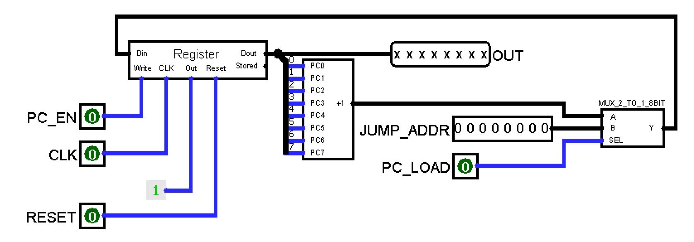
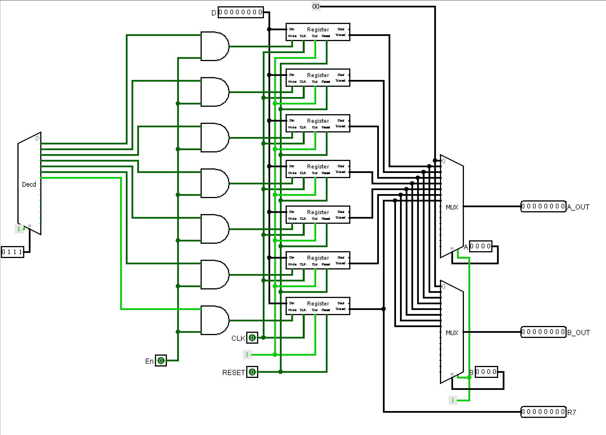
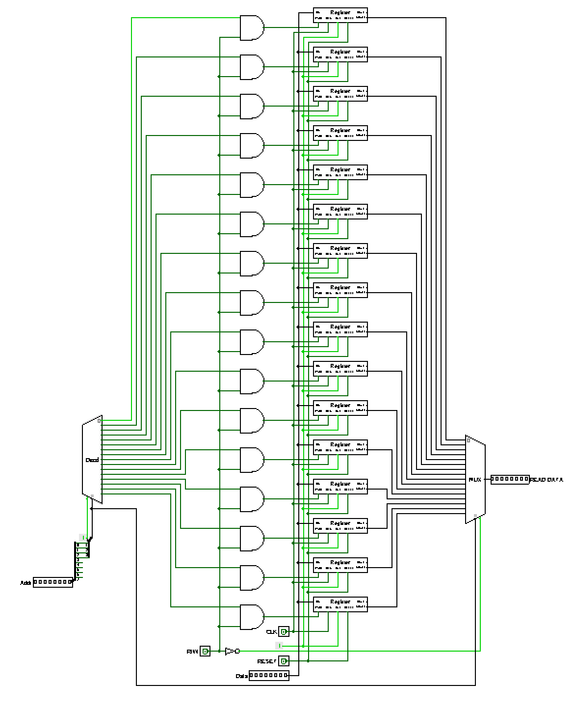

# 8-bit CPU in Logisim

A modular digital-logic CPU design built from registers, multiplexers, arithmetic/logic circuits, memory and control logic. The project explores an **8-bit datapath**, **16-bit instructions**, a register file and separate instruction/data memory.

The main design is the more developed **Google Drive submission**. Earlier local circuit shells and draft notes are preserved separately so they are easy to distinguish from that submission.

**Status: development design.** Wired subcircuits are present, but instruction execution, flag behavior, memory operations, branches and the Fibonacci objective have not been independently validated. This repository does not claim a completed, fully tested processor.

## Files

| File or folder | Contents |
| --- | --- |
| [circuits/cpu.circ](circuits/cpu.circ) | Submitted Drive design, renamed from `CPUTask_shell.circ` |
| [docs/design-report.docx](docs/design-report.docx) | Submitted design notes and circuit captures |
| [docs/circuit-inventory.json](docs/circuit-inventory.json) | Structural inventory of the submitted circuit file |
| [docs/evidence/](docs/evidence/) | Existing PC, register-file and data-memory screenshots extracted from the submitted report |
| [archive/local/](archive/local/) | Earlier local circuits, notes and a progress-report draft |

The original source/report contents are preserved. Folder and circuit filenames were changed only to organize the material.

## Design goals

- Eight 8-bit registers, R0 through R7, with R0 intended as a zero register and R7 as the data-memory address register.
- A program counter, separate instruction memory and a control unit for fetch/decode/execute behavior.
- Arithmetic and logic operations: ADD, SUB, NOR, AND, INC, DEC and right shift.
- Immediate loads, data-memory loads/stores, jumps, conditional branches, NOP and halt.
- Zero, carry and negative flags for control-flow decisions.

The report describes an 8-bit address interface but a reduced 16-entry data-memory implementation. These are intended architecture details from the documentation, not guarantees of correct operation.

## Implementation present in the submission

The submitted file contains wired `PC`, `Instruction Memory`, `Registers`, `ALU`, `Data Memory`, `Flags` and `Control Unit` subcircuits, together with supporting gates, adders, muxes, decoders and register/memory-cell circuits.

The top-level `main` circuit contains 19 components and 21 wire elements. These counts establish that it is more than the earlier empty shell; they do not establish a complete or correct datapath. Some auxiliary circuits, including `Call Stack` and `16:1 MUX`, have no wire elements and should be reviewed as unfinished or placeholder areas.

## Existing circuit captures

These images come from the submitted report and show historical design snapshots.

### Program counter

### Register file

### Data memory

## Open and investigate

1. Open `circuits/cpu.circ` in a compatible Logisim installation. Its project metadata declares source version **2.7.1**; compatibility with other editions has not been tested here.
2. Inspect `main`, then test the PC, register file, ALU and memory subcircuits independently.
3. Confirm reset, clock-edge, write-enable, bus-width and mux-select behavior before loading an instruction program.
4. Reconcile opcode values and operand bit fields with the actual instruction splitter and control-unit wiring.
5. Test each supported instruction with known register/memory values and record expected versus observed results.
6. Only after instruction execution is established, test jumps, branches, halt and the intended Fibonacci program.

No verified Fibonacci program image was located among the collected project files. No program or runtime test results have been invented for this repository.

## Documentation differences

The submitted notes and earlier local progress-report draft contain inconsistent opcode mappings and instruction-field layouts, including differing encodings for instructions such as LDI. The submitted notes also mix three-bit register-field descriptions with a nibble-oriented operand table.

Consequently, no authoritative machine-code table is asserted in this README. The archived progress report's claims of a fully functioning processor and successful Fibonacci execution are **unverified draft claims**. Treat those notes as development/reference material and check them against the submitted circuit before writing programs.

## Provenance and checks

- [Drive submission folder](https://drive.google.com/drive/folders/1C4nA7BiUzZPK7fsYCDkv5HEiEh9YoGSE).
- Circuit and report retrieved from the supplied Spider Electronics Drive collection on 20 October 2026.
- Original file copies were checked with SHA-256 hashes.
- The circuit XML parses successfully, and references to custom subcircuits resolve within the project file.
- This is a structural/source-file check; no fresh Logisim simulation or hardware test was performed.

Originally developed for the Spider Electronics custom-processor exercise. The repository is named after the processor design.
